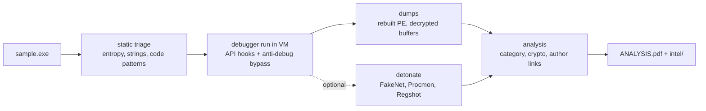
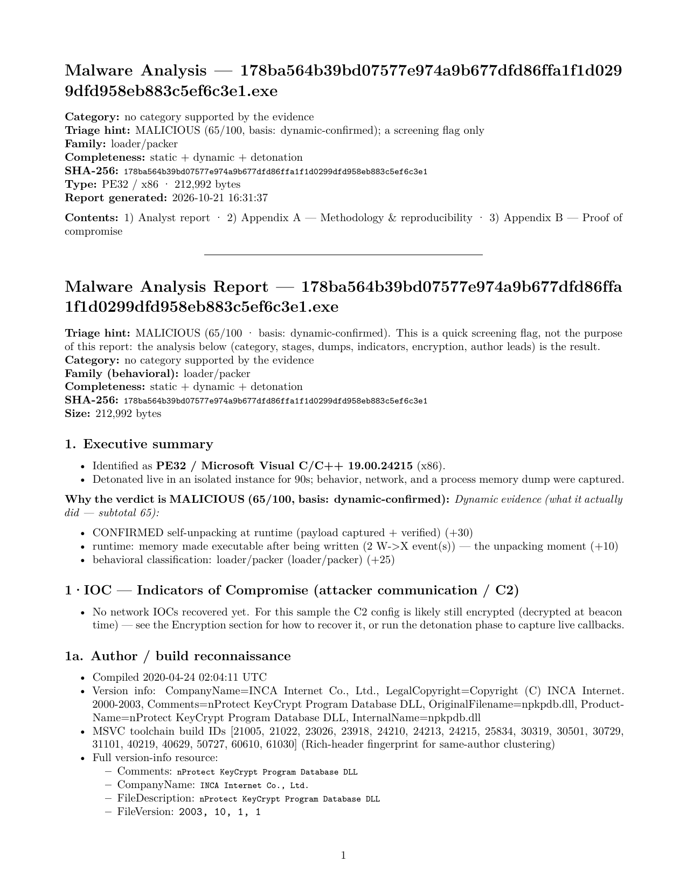
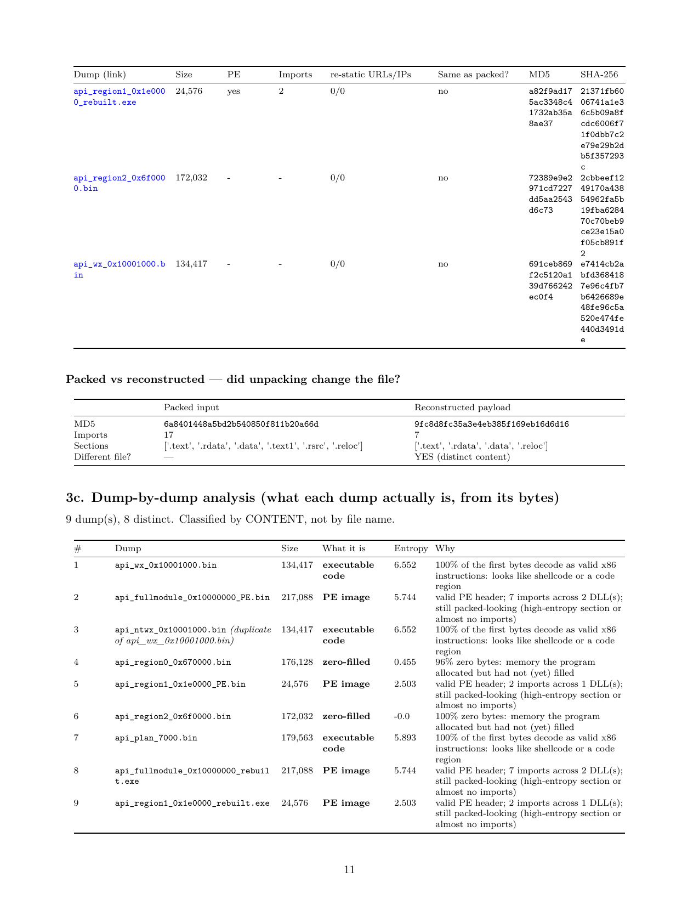
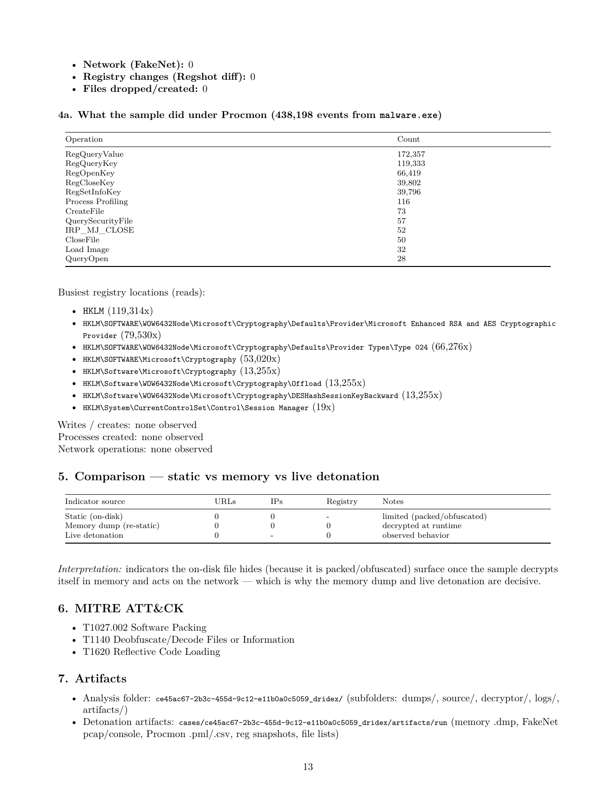

# Nemesis Analyst

**AI-assisted malware unpacking and analysis.** Point it at a packed Windows sample. It runs the sample under a
debugger inside a throwaway VM, catches the real payload as it unpacks itself, recovers encryption keys, and hands
you one PDF plus a ready-to-ship detection package (YARA, Sigma, Suricata, STIX, IOCs).

Automated dynamic + static malware analysis · x64dbg / x32dbg over SSH · memory unpacking · ransomware key
recovery and decryptor generation · malware family classification · YARA / Sigma / STIX export · driveable from
any LLM through the Model Context Protocol (MCP).

> ⚠️ Defensive security tooling for reverse engineers and threat analysts. Only analyse samples you are
> authorised to handle, inside an isolated, disposable VM.



## What you get

Every run writes its own folder, `cases/<uuid>_<malware>/`:

```
ANALYSIS.pdf      the one report
intel/            iocs.csv, yara/, sigma/, stix.json, hashes.txt
dumps/            every captured memory region, rebuilt PEs
decryptor/        a working decryptor, only if the key was recovered and proven
artifacts/        detonation output (pcap, Procmon log, registry diffs)
case.json         everything above, machine readable
```

The report tells you what the sample is (dropper, stealer, banker, worm, ransomware), what each dump contains,
which indicators were seen live and which are only guesses, and whether the author left fingerprints.
A malicious/benign score exists but it is one line, a triage hint.

## What the report looks like

A real run on a packed **Dridex** sample (the full PDF is in [docs/examples/dridex](docs/examples/dridex)):

| Cover — verdict, family, author recon | Dumps — every region classified by content |
|---|---|
|  |  |

The engine caught the self-unpacking at the write→execute flip, rebuilt the hidden payload into a valid PE,
and clustered the author's build fingerprints — without the on-disk file ever revealing them.

## Setup

You need a Mac or Linux host and a Windows VM you can throw away.

```
 host (this repo)  --ssh-->  Windows VM
   python, pandoc             x64dbg + MCP plugin  (port 3000)
                              FakeNet-NG, Procmon, Regshot  (detonation only)
```

**Host**

```bash
python3 -m pip install -r requirements.txt
brew install pandoc tectonic sshpass        # PDF output + password SSH (apt works too)
cp targets.example.json targets.json        # then edit it, or:
python3 remote_check.py --host 192.168.x.x --user lab --password '...' --save default
```

**Analysis VM** — any Windows 10/11 guest you can revert. The host only ever talks to it over **SSH**, so the
hypervisor does not matter: **VirtualBox, UTM (Apple Silicon), VMware, Hyper-V, QEMU, or a cloud instance** all work.

1. Install Windows, then **snapshot it clean** (you revert to this after every sample).
2. Enable **OpenSSH Server** (`Settings → Apps → Optional features → OpenSSH Server`, then start the `sshd` service).
   Note the VM's IP — that is the whole network setup. A host-only / NAT adapter with SSH reachable is enough.
3. Install **x32dbg/x64dbg** and an x64dbg **MCP server plugin** (a separate project, JSON-RPC over HTTP). Start the
   debugger on the desktop; the plugin listens on `127.0.0.1:3000` in the VM and the host tunnels to it over SSH.
4. For detonation only, put `Procmon64.exe`, `PsExec64.exe`, `pe-sieve64.exe` and a `fakenet\` folder (FakeNet-NG) in
   `C:\Tools`; Regshot is driven the same way. Paths are at the top of `nanalyst/detonate.py`.

Point the host at it once and you are done:

```bash
python3 remote_check.py --host <vm-ip> --user <vm-user> --password '<vm-pass>' --save default
```

**Optional**

| Thing | How |
|---|---|
| AI planning and audit of its claims | `export OPENAI_API_KEY=...`, or `cp kali_config.example.ini kali_config.ini` and add your key (any OpenAI-compatible endpoint via `base_url`). Everything works without it. |
| Detect It Easy | put `diec` on PATH or set `NANALYST_DIEC` |
| Ghidra | set `NANALYST_GHIDRA` to `analyzeHeadless` |

## Use it from an LLM (MCP)

The same pipeline is an MCP server, so your own assistant can walk you through static and dynamic analysis.

```json
{ "mcpServers": { "nemesis-analyst": { "command": "python3", "args": ["/path/to/nemesis-analyst/mcp_server.py"] } } }
```

Then ask: "analyse /path/to/sample.exe". It runs the `analysis_workflow` prompt: `setup_check`, triage, an analysis job in
the background (`start_analysis`, `run_status`), then `run_summary`, `get_report` and `get_iocs`.

- Static tools never execute the sample. Dynamic tools refuse to run unless the model passes `confirm_disposable_vm=true`.
- `start_detonation` is off until you set `NANALYST_ALLOW_DETONATION=1` in the server's own environment. The model cannot do that.
- Whatever comes from a sample is returned marked as untrusted data.

## Run it from the command line

```bash
# 1. unpack and analyse. The sample is stopped once its payload is captured.
python3 unpack.py path/to/sample.exe

# 2. revert the VM, then detonate for network and system behaviour.
python3 unpack.py path/to/sample.exe --detonate
```

Run step 2 on a clean VM, after step 1 is done. Detonation really executes the malware. It captures network
(FakeNet), a process + registry diff (Regshot) and everything the sample touched (Procmon) — e.g. on Dridex,
438k operations dominated by Cryptography-provider registry reads, the config decryption loop in plain sight:



| Flag | Does |
|---|---|
| `--detonate` | run it for real under FakeNet, Procmon and Regshot (about 4 minutes) |
| `--observe 60` | after unpacking, let the payload keep running 60 s under the hooks |
| `--no-ai` | skip the AI layer |
| `--finalize cases/<folder>` | rebuild every report from a saved case, no VM needed |

If a run is interrupted (closed terminal, Ctrl-C, crash) it stops the debuggee, saves what it has and still writes the reports.

## Safety

- Only run samples inside a VM with no route to anything you care about.
- After any run the VM may be dirty. The tool says so and checks for leftovers (processes, Run keys, tasks, services, files). Revert anyway.
- `samples/`, `cases/` and `targets.json` are git-ignored. Don't commit malware.

## Honest limits

- It stops at the first unpacking layer by default. Multi-layer packers need `--observe` or a second pass.
- Hook counts are lower bounds (">= 3"): the debugger plugin can't count calls without stopping the program.
- A file key wrapped by an attacker's RSA key can't be recovered offline, and the report says that.
- Author fingerprints (imphash, Rich header, timestamps) are leads, not proof.

## Layout

```
unpack.py             main pipeline
nanalyst/             engine, hooks, analysis, reports (see api_spec.py for the hooked APIs)
regen_reports.py      re-render reports from case.json
tests/                python3 -m pytest tests
ROADMAP.md            what is done and what is not
DETONATION_RUNBOOK.md the detonation sequence in detail
```

## License

MIT. Use it on samples you are allowed to analyse, in a VM you can throw away.

---

Created and maintained by **Obi Ebuka David**. Contributions welcome.
